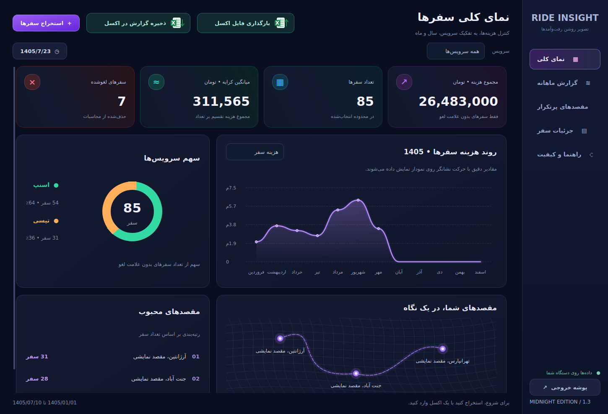

# Ride Insight 🌙

برنامه دسکتاپ فارسی برای استخراج و تحلیل تاریخچه سفرهای اسنپ و تپسی.

Ride Insight تاریخچه سفرها را از مرورگر دریافت می‌کند، در Excel ذخیره می‌کند و گزارش هزینه، تعداد سفر و مقصدهای پرتکرار را نمایش می‌دهد.



> اطلاعات نمایش‌داده‌شده در تصاویر پیش‌نمایش ساختگی هستند.

## امکانات

- استخراج تاریخچه سفرهای اسنپ و تپسی
- پیمایش خودکار تاریخچه سفرها
- ذخیره تدریجی خروجی Excel و JSON
- ورود فایل‌های Excel قبلی و تحلیل آن‌ها
- نمایش مجموع هزینه و تعداد سفرها
- گزارش سالانه و ماهانه با تاریخ شمسی
- حذف سفرهای لغوشده از محاسبات هزینه و تعداد سفر
- نمایش مقصدهای پرتکرار
- رابط فارسی و راست‌به‌چپ با تم تیره
- اجرای محلی بدون نیاز به هاست

## نصب و اجرا

### پیش‌نیازها

- Windows
- Python 3.11
- Google Chrome
- اینترنت برای نصب وابستگی‌ها و استخراج سفرها

پس از دریافت پروژه و استخراج ZIP، فایل زیر را اجرا کنید:

`install_and_run.bat`

این فایل وابستگی‌ها را نصب و برنامه را اجرا می‌کند.

برای اجراهای بعدی از فایل زیر استفاده کنید:

`run.bat`

نیازی به دانلود Chromium از طریق Playwright نیست؛ برنامه از Chrome نصب‌شده استفاده می‌کند.

## روش استخراج سفرها

### اسنپ

1. در برنامه وارد بخش «استخراج سفر» شوید.
2. سرویس «اسنپ» را انتخاب کنید.
3. دکمه «باز کردن مرورگر» را بزنید.
4. در مرورگر بازشده شماره تلفن و کد تأیید را وارد کنید.
5. مطمئن شوید صفحه تاریخچه سفرها باز است و کارت‌های سفر نمایش داده می‌شوند.
6. به برنامه برگردید و دکمه «ورود انجام شد؛ استخراج کن» را بزنید.
7. منتظر بمانید تا پیمایش، استخراج و ذخیره‌سازی تمام شود.
8. پس از نمایش پیام پایان، گزارش را مشاهده کنید یا پوشه خروجی را باز کنید.

### تپسی

1. در برنامه وارد بخش «استخراج سفر» شوید.
2. سرویس «تپسی» را انتخاب کنید.
3. دکمه «باز کردن مرورگر» را بزنید.
4. در مرورگر شماره تلفن و کد تأیید را وارد کنید.
5. پس از ورود، از بخش «پروفایل»، صفحه «سفرهای من» را دستی باز کنید.
6. پس از نمایش کارت‌های سفر، به برنامه برگردید.
7. دکمه «ورود انجام شد؛ استخراج کن» را بزنید.
8. تا پایان استخراج و ذخیره‌سازی منتظر بمانید.

> در تپسی، بازکردن دستی «پروفایل ← سفرهای من» قبل از شروع استخراج ضروری است.

برای استخراج از سرویس دیگر، پس از پایان کار سرویس اول، مراحل را برای سرویس دوم تکرار کنید.

مرورگر را حین استخراج نبندید. در صورت نیاز، از دکمه «توقف و ذخیره» استفاده کنید؛ خروجی ممکن است ناقص باشد.

## پایان خودکار استخراج

وقتی برنامه در انتهای صفحه حدود ۲۰ ثانیه پیشرفتی مشاهده نکند، استخراج را تمام می‌کند و خروجی نهایی را ذخیره می‌کند.

این معیار کامل‌بودن تاریخچه را تضمین نمی‌کند؛ تعداد و قدیمی‌ترین سفر را با سایت مقایسه کنید.

## محل ذخیره خروجی

فایل‌ها در این مسیر ذخیره می‌شوند:

`%LOCALAPPDATA%\RideInsight\exports`

با دکمه پوشه خروجی می‌توانید این مسیر را باز کنید.

## تحلیل فایل Excel

از دکمه «ورود اکسل» استفاده کنید.

برای فایل‌های قدیمی، قبل از ورود فایل، سرویس مربوط به آن را انتخاب کنید.

فیلترهای سال و ماه در بخش گزارش ماهانه قرار دارند. خروجی Excel این بخش، فیلتر همان صفحه را اعمال می‌کند.

## نکات محاسبات

- سفرهای دارای علامت لغو در تعداد و هزینه سفرهای انجام‌شده محاسبه نمی‌شوند.
- وضعیت خالی یعنی علامت لغو در اطلاعات استخراج‌شده مشاهده نشده است؛ تأیید بانکی پرداخت نیست.
- مبلغ نمایش‌داده‌شده در کارت الزاماً برابر پرداخت نهایی بانکی نیست.
- تاریخ‌های بدون سال با استفاده از تاریخ مبنا و ترتیب سفرها تخمین زده می‌شوند و ممکن است به بررسی نیاز داشته باشند.
- رکوردهای دارای مبلغ و بدون تاریخ در مجموع کل لحاظ می‌شوند، اما در گزارش سالانه و ماهانه قرار نمی‌گیرند.
- نمایش مسیرها شماتیک است و موقعیت جغرافیایی واقعی را نشان نمی‌دهد.

## حریم خصوصی

ورود به حساب توسط خود کاربر در مرورگر انجام می‌شود.

برنامه در کد خود شماره تلفن، کد تأیید یا کوکی ورود را استخراج و ذخیره نمی‌کند.

خروجی سفرها می‌تواند شامل آدرس و اطلاعات شخصی باشد؛ فایل‌های Excel و JSON خود را عمومی نکنید.

## ساخت نسخه ویندوز

برای ساخت نسخه اجرایی، فایل زیر را روی ویندوز اجرا کنید:

`build_exe.bat`

مسیر خروجی:

`dist\RideInsight\RideInsight.exe`

برای توزیع، کل پوشه `dist\RideInsight` لازم است؛ فقط فایل EXE را جدا نکنید.

## اجرای تست‌ها

در پوشه پروژه اجرا کنید:

```bash
python -m unittest discover -s tests -v
```

## فناوری‌ها

Python · PySide6 · Playwright · openpyxl · PyInstaller

## محدودیت‌ها

این پروژه مستقل است و وابستگی رسمی به اسنپ یا تپسی ندارد.

تغییر ظاهر سایت‌ها ممکن است استخراج را مختل کند. استفاده باید مطابق شرایط سرویس مربوط و فقط برای اطلاعاتی باشد که مجاز به دسترسی به آن‌ها هستید.